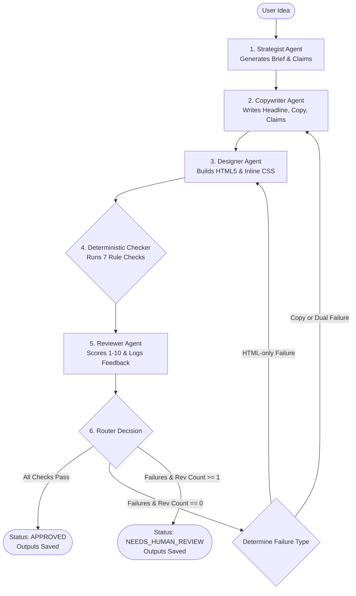

# Ad Studio 🚀

> **Ad Studio** is a Go-powered CLI tool that transforms a one-line business idea into a fully compliant, responsive, single-page HTML landing page. A multi-agent AI pipeline drafts and polishes the page, while a deterministic compliance engine acts as the strict gatekeeper. Everything is fictional: no real brands, no medical cures, no deceptive claims.

---

## Table of Contents
- [Core Philosophy](#core-philosophy)
- [Architecture & Pipeline Workflow](#architecture--pipeline-workflow)
- [Generated Artifacts](#generated-artifacts)
- [Prerequisites](#prerequisites)
- [Quickstart & Command Guide](#quickstart--command-guide)
  - [1. Running via Make (Fastest)](#1-running-via-make-fastest)
  - [2. Building and Running the CLI Binary](#2-building-and-running-the-cli-binary)
  - [3. Running Live with Gemini API](#3-running-live-with-gemini-api)
  - [4. Code Quality & Format Checks (`make check`)](#4-code-quality--format-checks-make-check)
  - [5. Regression Evaluation Suite (`make eval`)](#5-regression-evaluation-suite-make-eval)
  - [6. Cleaning Up Artifacts (`make clean`)](#6-cleaning-up-artifacts-make-clean)
- [Deterministic Compliance Checker (The 7 Gates)](#deterministic-compliance-checker-the-7-gates)
- [State Machine & Routing Logic](#state-machine--routing-logic)
- [Topic Vertical Detection & Visual Themes](#topic-vertical-detection--visual-themes)
- [Project Structure](#project-structure)

---

## Core Philosophy

Modern generative workflows require safeguards against hallucinations, unverified claims, and broken outputs:
1. **AI Proposes, Deterministic Code Disposes**: AI agents generate the brief, copy, layout, and advisory review, but an unyielding, 100% deterministic rule engine decides whether the output is approved.
2. **Advisory Reviewer**: The LLM reviewer scores the landing page (1–10) and provides qualitative feedback. However, its score is advisory—it **never** overrides checker failures.
3. **Strict Revision Limit**: The pipeline permits at most **one** revision pass (`revision_count <= 1`). If issues persist after revision, the run concludes with `needs_human_review` to prevent infinite loops and runaway costs.
4. **Zero-Dependency Core**: Built with the Go standard library—no heavy web frameworks, external databases, or UI servers.

---

## Architecture & Pipeline Workflow



### Pipeline Node Roles
- **Strategist**: Analyzes the one-line concept and extracts target audience, offer, tone, allowed claims, and explicitly banned claims.
- **Copywriter**: Crafts high-converting ad copy (headline, subhead, bullet benefits, CTA, disclaimer) adhering strictly to allowed claims.
- **Designer**: Translates the copy and brief into clean, semantic, responsive HTML5 with embedded CSS styling.
- **Checker**: Executes 7 deterministic compliance and structure tests without LLM involvement.
- **Reviewer**: Evaluates design cohesion and clarity, issuing an advisory score (1–10) and critique.
- **Router**: Directs traffic based purely on checker results and revision count.

---

## Generated Artifacts

Every execution outputs three root artifacts:

| Artifact | File | Description |
|---|---|---|
| **Landing Page** | `page.html` | Semantic, responsive HTML5 landing page with inline styling, viewport meta, single `<h1>`, and custom CTA. |
| **Strategy Brief** | `brief.json` | Campaign blueprint containing `audience`, `offer`, `tone`, `allowed_claims`, and `banned_claims`. |
| **Audit Trace** | `trace.json` | Complete RFC3339-timestamped log of every agent execution, checker verdict, reviewer score, and routing step. |

---

## Prerequisites

- **Go**: Version `1.20` or higher ([Download Go](https://go.dev/dl/))
- **Make**: Standard build automation utility (pre-installed on macOS and Linux)

Verify your environment:
```bash
go version
make --version
```

---

## Quickstart & Command Guide

### 1. Running via Make (Fastest)

You can run the full end-to-end pipeline directly with `make` by passing your prompt in quotes:

```bash
# Hair care subscription
make "landing page for Strand, a fictional hair care subscription"

# Gym / Fitness membership
make "landing page for IronPulse, a fictional 24/7 strength gym"

# Artisan coffee subscription
make "landing page for BrewCraft, a fictional artisan coffee subscription"

# SaaS / Productivity app
make "landing page for Nova, a fictional smart task organizer for teams"
```

### 2. Building and Running the CLI Binary

Compile the standalone binary into `bin/adstudio`:

```bash
# Compile binary
make build

# Run binary with your prompt
./bin/adstudio "landing page for Strand, a fictional hair care subscription"
```

#### Custom Output Directory
Direct the generated files (`page.html`, `brief.json`, `trace.json`) to a custom directory with the `--out` flag:

```bash
./bin/adstudio --out ./dist/haircare "landing page for Strand, a fictional hair care subscription"
```

### 3. Running Live with Gemini API

By default, Ad Studio runs in offline mode using its smart contextual mock generator. To run with live Gemini models:

1. Obtain a Gemini API key from [Google AI Studio](https://aistudio.google.com/).
2. Export the environment variable:
   ```bash
   export GEMINI_API_KEY="your-gemini-api-key"
   ```
3. Optionally configure the model (defaults to `gemini-2.5-flash`):
   ```bash
   export GEMINI_MODEL="gemini-2.5-flash"
   ```
4. Run with the `--live` flag:
   ```bash
   ./bin/adstudio --live "landing page for Strand, a fictional hair care subscription"
   ```
*(Note: If the API key is unset or a network error occurs, it will automatically fallback to the contextual mock model.)*

### 4. Code Quality & Format Checks (`make check`)

Run the automated linter, formatter check, and complete unit test suite:

```bash
make check
```

This runs:
- `gofmt -l`: Ensures all code conforms to standard Go formatting.
- `go vet ./...`: Detects subtle code flaws and structural warnings.
- `go test -v ./...`: Runs all unit test suites across `agent`, `checker`, `graph`, `model`, and `output`.

### 5. Regression Evaluation Suite (`make eval`)

Run the 6 scripted regression eval test cases to verify router integrity and gatekeeper safety without any external network calls:

```bash
make eval
```

**Expected Eval Output:**
```
| Case | Expected            | Actual              | Pass/Fail |
|---|---|---|---|
| 1    | approved            | approved            | PASS      |
| 2    | approved            | approved            | PASS      |
| 3    | needs_human_review  | needs_human_review  | PASS      |
| 4    | approved            | approved            | PASS      |
| 5    | needs_human_review  | needs_human_review  | PASS      |
| 6    | needs_human_review  | needs_human_review  | PASS      |

Score: 6/6 passed (100.0%)
```

### 6. Cleaning Up Artifacts (`make clean`)

Remove compiled binaries and locally generated root files:

```bash
make clean
```

---

## Deterministic Compliance Checker (The 7 Gates)

The checker package ([internal/checker/checker.go](file:///Users/starq0/codingz/flux-interview-proj/internal/checker/checker.go)) validates the pipeline outputs against 7 hard rules:

| # | Check Name | Target | Rule Description |
|---|---|---|---|
| 1 | `required_copy_sections` | Copy | Must include non-empty `headline`, `subhead`, `benefits` (at least 1), `cta`, and `disclaimer`. |
| 2 | `banned_phrases` | Copy | Prohibits deceptive phrases (e.g., *"free money"*, *"guaranteed profit"*, *"risk-free"*, *"miracle cure"*). |
| 3 | `claims_match_allowed` | Copy | Every claim in copy must strictly match an allowed claim defined in the strategist's brief. |
| 4 | `headline_length` | Copy | Headline must contain **12 words or fewer** for optimal readability and impact. |
| 5 | `html_viewport_meta` | HTML | Must declare `<meta name="viewport" content="...">` for responsive mobile scaling. |
| 6 | `html_single_h1` | HTML | Must have exactly one `<h1>` tag in the DOM hierarchy for semantic SEO. |
| 7 | `html_required_content` | HTML | Must include the copy's headline, subhead, CTA button, disclaimer, and all benefit items. |

---

## State Machine & Routing Logic

The routing engine ([internal/graph/router.go](file:///Users/starq0/codingz/flux-interview-proj/internal/graph/router.go)) guarantees deterministic outcomes:

- **Pass All Checks**: Routes to `approved`.
- **Pass 1 Failures (`revision_count == 0`)**:
  - **Copy-only failure**: Routes back to `copywriter` with checker error feedback.
  - **HTML-only failure**: Routes back to `designer` with HTML syntax/structure feedback.
  - **Dual failure (both copy & HTML)**: Prioritizes routing to `copywriter` first, then designer and checker re-run automatically.
- **Pass 2 Failures (`revision_count >= 1`)**:
  - Immediately terminates at `needs_human_review`. Never loops indefinitely.
- **Strategist Parse Failure**:
  - Unparseable strategist output routes straight to `needs_human_review`.
- **Reviewer Independence**:
  - Reviewer score (1–10) is logged in `trace.json` for human inspection, but cannot overturn checker verdicts.

---

## Topic Vertical Detection & Visual Themes

When running offline or without an API key, the `ContextualMockModel` analyzes the prompt's business vertical and crafts matching themes, copy, and palettes:

```
├── Fitness / Gym      --> Dark athletic slate (#0f141c), energetic red CTA (#e63946)
├── Coffee / Beverage  --> Dark roast espresso (#1c1613), warm amber CTA (#c07a3e)
├── Haircare / Beauty  --> Deep botanical forest (#0b1d16), emerald CTA (#2d6a4f)
├── Tech / SaaS        --> Modern deep navy (#0b0f19), indigo CTA (#6366f1)
└── Bespoke / Other    --> Clean slate (#0f172a), sky blue CTA (#0284c7)
```

Each vertical produces unique audience targeting, allowed claims, benefit points, and headline messaging matching the domain.

---

## Project Structure

```
.
├── cmd/
│   └── adstudio/          # CLI binary entrypoint (main.go)
├── internal/
│   ├── agent/             # Strategist, Copywriter, Designer, and Reviewer implementations
│   ├── checker/           # 7 deterministic safety and compliance checks
│   ├── graph/             # State machine, router decision matrix, and trace logger
│   ├── model/             # Gemini REST client & smart contextual mock generator
│   └── output/            # File persistence for page.html, brief.json, trace.json
├── eval/
│   ├── runner.go          # Deterministic eval harness runner
│   └── testdata/          # 6 scripted eval test cases (cases 1-6)
├── docs/                  # System specifications (product-brief.md, graph.md, harness-eval.md)
├── AGENTS.md              # Project guidelines and constraints (<100 lines)
├── Makefile               # CLI automation (check, eval, build, clean, and make "<idea>")
└── README.md              # Project overview and hand-holding guide
```
