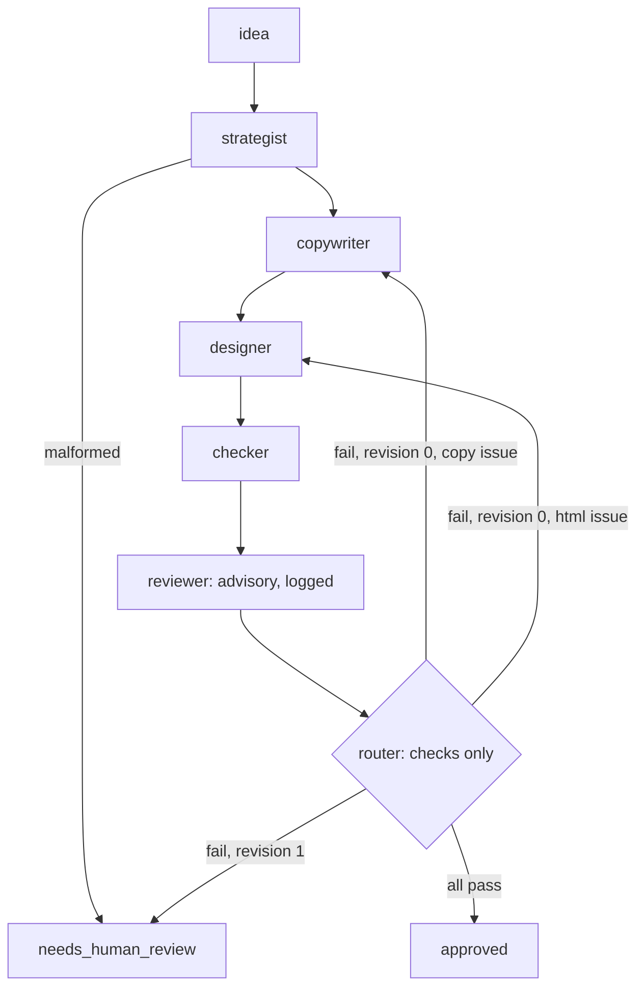

# Ad Studio: Graph

## State passed between nodes
| Field | Set by | Notes |
|---|---|---|
| `idea` | CLI input | One-line idea |
| `brief` | strategist | Audience, offer, tone, `allowed_claims`, `banned_claims`, `allowed_banned_phrases` |
| `copy` | copywriter | Headline, subhead, 3 benefits, CTA, disclaimer, structured `claims` list |
| `html` | designer | Contents of `page.html` |
| `check_results` | checker | Pass/fail per check |
| `review` | reviewer | Tone and clarity score. Advisory only |
| `revision_count` | router | 0 or 1. Never goes above 1 |
| `status` | router | `approved` or `needs_human_review` |
| `trace` | every node | Written to `trace.json` |

## Nodes
| Node | Input | Output |
|---|---|---|
| strategist | `idea` | `brief` |
| copywriter | `brief` (plus failed checks on revision) | `copy` |
| designer | `brief`, `copy` (plus failed checks on revision) | `html` |
| checker | `brief`, `copy`, `html` | `check_results` (deterministic) |
| reviewer | `copy`, `html` | `review` score, logged only |
| router | `check_results`, `revision_count` | next node or final `status` |

## Branches
1. **Strategist output malformed** → `needs_human_review`. No revision.
2. **All checks pass** → `approved`.
3. **A check fails, `revision_count` is 0** → `revision_count` becomes 1, then:
   - copy failure (banned phrase, claim not in allowed claims, headline over 12 words, missing copy section) → back to **copywriter**, then designer and checker run again.
   - HTML failure (missing section in the page, no viewport meta, not exactly one h1) → back to **designer**, then checker runs again.
4. **A check fails, `revision_count` is 1** → `needs_human_review`.
5. **Copywriter, designer or checker output malformed** → counts as a failed check and follows branch 3 or 4.

## Rules
- One revision maximum per run.
- Only deterministic checks drive the router. The reviewer score never changes a route.
- No path leads to `approved` unless every check passes.

## Stop conditions
- `approved`
- `needs_human_review`

## Diagram

## Open items
- If a single failed pass has both copy and HTML failures, which node gets the one revision? TBD.